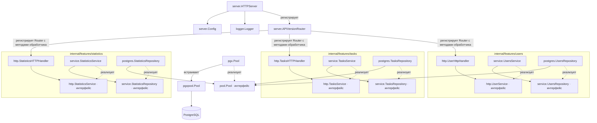
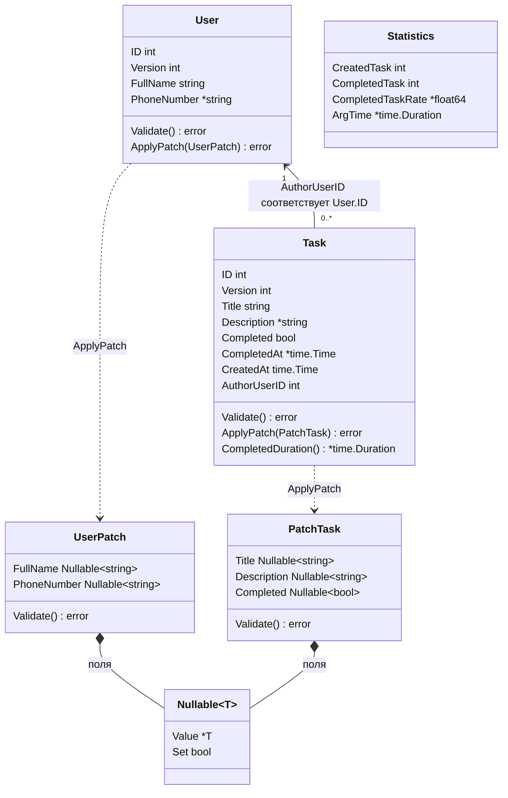

# Граф структур проекта

Схемы составлены по структурам и конструкторам в исходном коде.
`main` в `cmd/todoapp/main.go` создаёт пул, репозитории, сервисы,
обработчики и HTTP-сервер, затем регистрирует маршруты `/api/v1`.

## Основные зависимости

Сплошная стрелка показывает зависимость от поля или вызов при регистрации
маршрутов. Пунктирная стрелка с подписью «реализует» показывает реализацию
Go-интерфейса. Имена интерфейсов дополнены пакетом, чтобы отличать их
от одноимённых структур.

Обработчики хранят интерфейсы сервисов, сервисы хранят интерфейсы
репозиториев, репозитории хранят интерфейс `pool.Pool`. Конкретные
реализации передаются через конструкторы в `main`.
`APIVersionRouter` регистрирует функции обработчиков через `Router`;
отдельных полей для обработчиков в нём нет.

## Доменные структуры

Связь `Task → User` реализована идентификатором `AuthorUserID`, а не
вложенной структурой `User`. В БД это внешний ключ `tasks.author_id →
users.id` с `ON DELETE CASCADE`.

`StatisticsService` получает `[]domain.Task` из своего репозитория и
вычисляет `domain.Statistics`. Отдельной таблицы статистики нет.
`Nullable[T]` различает отсутствующее поле (`Set == false`), явный `null`
(`Set == true`, `Value == nil`) и переданное значение.

## Преобразование данных

```mermaid
flowchart LR
    JSON["JSON запроса"] --> Request["HTTP Request DTO"]
    Request --> Domain["domain.User / Task / UserPatch / PatchTask"]
    Domain --> Service["Сервис: проверка и применение изменений"]
    Service --> Repository["PostgreSQL-репозиторий"]
    Repository --> Model["UserModel / TaskModel"]
    Model --> Result["domain.User / Task"]
    Result --> Response["HTTP Response DTO"]
    Response --> Output["JSON ответа"]
```

Схема преобразования обобщает операции создания, чтения и изменения.
Удаление возвращает ошибку или успешный статус без доменного результата.
Для статистики сервис преобразует список задач в `domain.Statistics`,
а обработчик — в `GetStatisticsResponse`.
